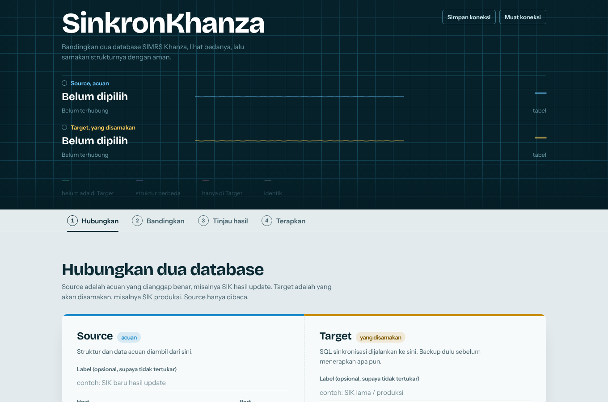
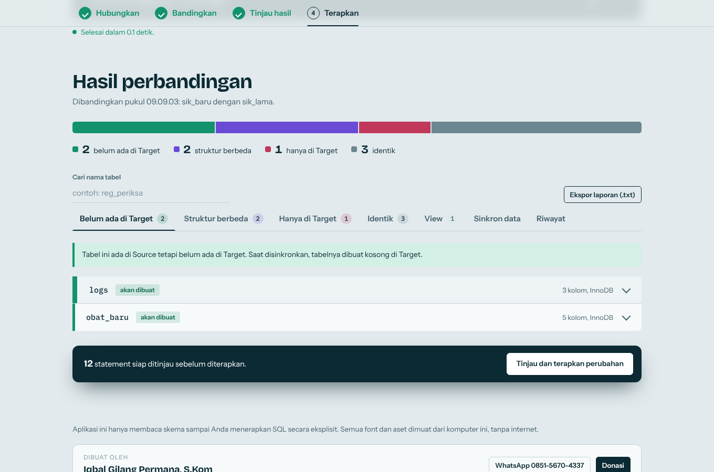
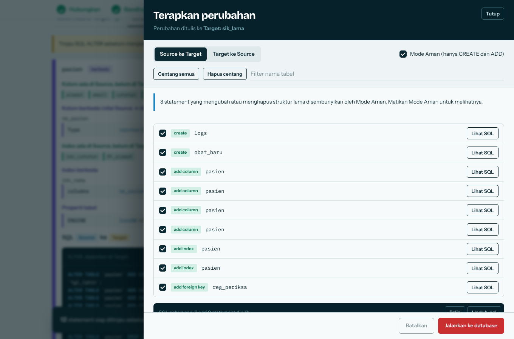

# SinkronKhanza

Pembanding dan penyinkron **struktur** database MySQL/MariaDB untuk **SIMRS Khanza**, mirip fitur *Structure Synchronization* di Navicat,
tetapi gratis, ringan, berjalan di browser, dan tidak butuh internet.



## Fitur

- Bandingkan dua database: tabel, kolom (tipe, null, default, extra, collation, komentar, kolom generated), index, foreign key, ENGINE, collation, komentar tabel, ROW_FORMAT, dan definisi view.
- Hasil dikelompokkan: belum ada di Target, struktur berbeda, hanya di Target, identik, view.
- Menghasilkan SQL `CREATE TABLE` / `ALTER TABLE` per tabel. Anda memilih mana yang dijalankan.
- **Mode Aman** (default): hanya menambah (tabel, kolom, index, foreign key). Dipaksa oleh server, bukan sekadar tampilan.
- Sinkron data sederhana: `INSERT` baris yang belum ada di Target (berdasarkan PRIMARY KEY). Tidak ada UPDATE atau DELETE.
- Backup database Target (`mysqldump`/`mariadb-dump`, dengan cadangan Python), ekspor laporan `.txt`, riwayat eksekusi.
- Simpan profil koneksi (tanpa password) dan tampilan responsif.
- **Animasi dan motion penuh**: tirai pembuka dengan garis EKG, judul yang muncul huruf demi huruf, latar gradien hidup, monitor EKG yang berdenyut saat tombol diklik, kartu yang menyorot mengikuti kursor, tombol magnetik, progres scroll, dan konfeti saat sinkronisasi sukses.
  Semua dimatikan otomatis bila sistem Anda memakai pengaturan *reduce motion*, dan dijeda saat tab tidak terlihat.
- Hardening keamanan: hanya `127.0.0.1` secara default, token CSRF, cek Host dan Origin, CSP, allowlist SQL, Basic Auth opsional.

| Hasil banding | Laci penerapan |
|---|---|
|  |  |

## Persyaratan

- Python **3.9 atau lebih baru** (disarankan 3.11+)
- Akses jaringan ke server MySQL/MariaDB yang ingin dibandingkan (akun dengan hak `SELECT`; hak `CREATE`/`ALTER` hanya perlu di Target jika ingin menerapkan perubahan)
- Opsional: `mysqldump` atau `mariadb-dump` di PATH untuk backup yang lengkap (view, trigger, routine)

## Instalasi

### Windows
1. Pasang Python dari https://www.python.org/downloads/ . Centang **Add Python to PATH** saat instalasi.
2. Unduh proyek ini (**Code → Download ZIP**) lalu ekstrak, atau `git clone`.
3. Klik dua kali **`run.bat`**. Pertama kali ia membuat lingkungan virtual dan memasang dependensi otomatis.
4. Browser terbuka otomatis ke **http://127.0.0.1:5000** (jika tidak, buka alamat itu sendiri).

### Linux / macOS
```bash
git clone https://github.com/USERNAME/sinkronkhanza.git
cd sinkronkhanza
./run.sh
```
Jika `run.sh` belum bisa dijalankan: `chmod +x run.sh`. Di Debian/Ubuntu mungkin perlu `sudo apt install python3-venv`.
Lalu buka **http://127.0.0.1:5000**.

### Manual
```bash
python -m venv .venv
source .venv/bin/activate        # Windows: .venv\Scripts\activate
pip install -r requirements.txt
python app.py
```

## Cara pakai

1. **Hubungkan.** Isi koneksi **Source** (acuan, biasanya database yang sudah benar) dan **Target** (database yang akan disamakan).
   Klik *Uji koneksi dan muat database*, lalu pilih database di kedua sisi. Klik *Simpan koneksi* bila ingin memakainya lagi (password tidak disimpan).
2. **Backup dulu.** Perubahan DDL di MySQL tidak bisa di-rollback. Unduh backup Target sebelum menerapkan apa pun.
3. **Bandingkan.** Klik *Bandingkan skema*. Database Khanza yang besar (500+ tabel) bisa butuh setengah sampai dua menit.
4. **Tinjau.** Buka tab hasil (Belum ada di Target, Struktur berbeda, dan seterusnya). Klik satu tabel untuk melihat detail dan SQL-nya.
5. **Terapkan.** Buka laci *Terapkan*, centang statement yang diinginkan, pilih arah, lalu jalankan.
   Untuk menulis ke database, ketik nama database tujuan sebagai konfirmasi.
   Jika ada statement gagal, laci menawarkan alat perbaikan dan Anda dapat melanjutkan sisanya.
6. **Data (opsional).** Tab Data menampilkan tabel yang barisnya kurang di Target. Pratinjau dulu, lalu sinkronkan.

### Mode Aman
Aktif secara default. Hanya `CREATE TABLE` dan penambahan (`ADD COLUMN`, `ADD INDEX`, `ADD FOREIGN KEY`) yang dijalankan.
Perubahan yang mengubah objek yang sudah ada (`MODIFY COLUMN`, ganti index, ganti foreign key, ENGINE, collation) baru boleh dijalankan jika Mode Aman dimatikan.
`DROP COLUMN` dan `DROP TABLE` **tidak pernah** dijalankan oleh aplikasi ini.

### Akses dari komputer lain di LAN
Secara default aplikasi hanya bisa dibuka dari komputer yang sama. Untuk membuka ke jaringan, **wajib** memakai password:

```bash
DBSYNC_HOST=0.0.0.0 DBSYNC_PASSWORD='ganti-dengan-password-kuat' DBSYNC_ALLOWED_HOSTS=nama-pc-server ./run.sh
```
Windows (PowerShell):
```powershell
$env:DBSYNC_HOST="0.0.0.0"; $env:DBSYNC_PASSWORD="ganti-dengan-password-kuat"; $env:DBSYNC_ALLOWED_HOSTS="nama-pc-server"; .\run.bat
```
Tanpa `DBSYNC_PASSWORD`, aplikasi menolak start di alamat selain loopback.

## Konfigurasi

| Variabel | Default | Fungsi |
|---|---|---|
| `DBSYNC_HOST` | `127.0.0.1` | Alamat listen. Selain loopback wajib set `DBSYNC_PASSWORD`. |
| `DBSYNC_PORT` | `5000` | Port. |
| `DBSYNC_PASSWORD` | kosong | Mengaktifkan Basic Auth (user bebas). Wajib bila diakses dari jaringan. |
| `DBSYNC_ALLOWED_HOSTS` | kosong | Nama host tambahan yang boleh dipakai di URL, pisah koma. |
| `DBSYNC_ALLOWED_DB_HOSTS` | kosong | Batasi server MySQL yang boleh dihubungi, pisah koma. |
| `DBSYNC_DEBUG` | `0` | Debug Flask. Hanya boleh di loopback. |
| `DBSYNC_OPEN_BROWSER` | `1` | Buka browser otomatis saat server siap. Set `0` untuk mematikan. |

### Mode debug

`Debug mode: off` (atau "Mode debug: mati") berarti aplikasi berjalan normal. **Biarkan mati** untuk pemakaian sehari-hari.
Mode debug hanya untuk orang yang mengubah kode: server restart otomatis saat file berubah dan error tampil lengkap di browser.
Karena debugger Flask bisa dipakai menjalankan kode di komputer Anda, aplikasi menolak mode debug bila dibuka ke jaringan.

Menyalakan (hanya di komputer sendiri, `127.0.0.1`):

```bash
# Linux / macOS
DBSYNC_DEBUG=1 ./run.sh
```
```bat
:: Windows (cmd)
set DBSYNC_DEBUG=1
run.bat
```
```powershell
# Windows (PowerShell)
$env:DBSYNC_DEBUG="1"; .\run.bat
```
Untuk mematikannya lagi, tutup jendela terminal lalu jalankan tanpa variabel itu.

## Pemecahan masalah

| Gejala | Penyebab dan solusi |
|---|---|
| `Access denied for user` | Username/password salah, atau akun belum diizinkan dari host ini (`GRANT ... TO 'user'@'host'`). |
| `Can't connect to MySQL server` | Server mati, port salah, firewall, atau `bind-address` MySQL hanya lokal. |
| `RuntimeError: 'cryptography' package is required` | Jalankan `pip install -r requirements.txt` (dibutuhkan MySQL 8 `caching_sha2_password`). |
| `403 Host tidak diizinkan` | Anda membuka lewat nama host lain. Tambahkan ke `DBSYNC_ALLOWED_HOSTS`. |
| Backup hanya berisi tabel | `mysqldump`/`mariadb-dump` tidak ada di PATH. Pasang klien MySQL/MariaDB. |
| Statement gagal karena foreign key | Cek urutan tabel dan ENGINE yang sama pada tabel induk dan anak. |

## Batasan

- **Belum dibandingkan**: trigger, stored procedure/function, event, CHECK constraint, partisi.
- View hanya dibandingkan, tidak disinkronkan otomatis.
- Sinkron data hanya `INSERT`; tabel tanpa PRIMARY KEY dilewati.
- Rename kolom terbaca sebagai satu kolom hilang dan satu kolom baru.

## Keamanan

Aplikasi ini tidak menyimpan password database dan tidak mengirim apa pun ke internet. Meski demikian, ia tetap alat yang bisa mengubah struktur database.
Jangan diekspos ke internet publik. Selalu uji pada salinan database sebelum produksi.
Menemukan celah? Hubungi penulis lewat WhatsApp di bawah, jangan membuat issue publik.

## Kontribusi

Issue dan pull request dipersilakan. Sertakan versi Python, versi MySQL/MariaDB, dan langkah mengulang masalah (tanpa data pasien atau password).

## Lisensi

[MIT](LICENSE). Bebas dipakai, diubah, dan disebarkan, dengan syarat pemberitahuan hak cipta tetap dipertahankan.
Lisensi font dan dependensi ada di [NOTICE.md](NOTICE.md).

## Penulis dan donasi

Dibuat oleh **Iqbal Gilang Permana, S.Kom**.

- WhatsApp: [0851-5670-4337](https://wa.me/6285156704337)
- Donasi: **Bank Jago 103795214092**. Di aplikasi, klik tombol **Donasi** di footer, pilih bank Anda (Jago, BSI, Mandiri, BRI, BNI, BCA, Muamalat), dan nomor rekening otomatis disalin.

Jika alat ini menghemat waktu Anda, donasi seikhlasnya sangat membantu pengembangan berikutnya. Terima kasih.

> SinkronKhanza adalah proyek independen. Selamat mencoba!
